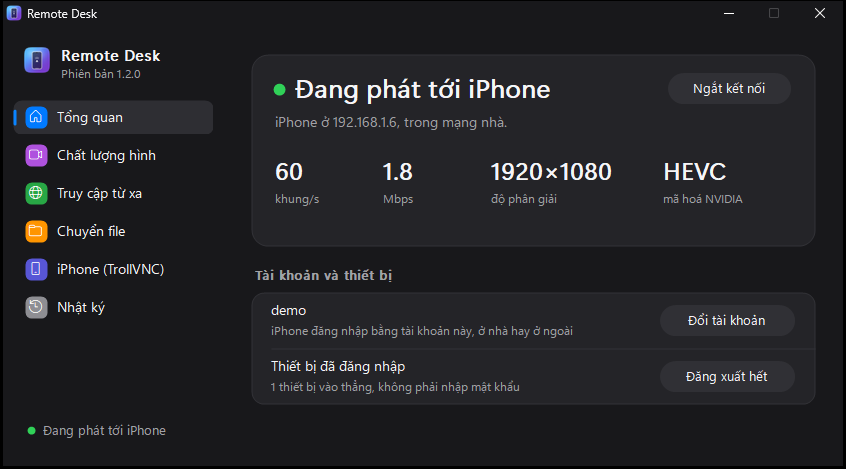
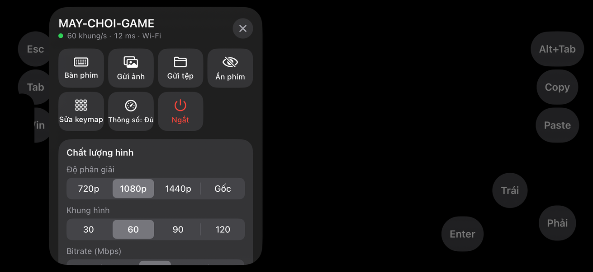
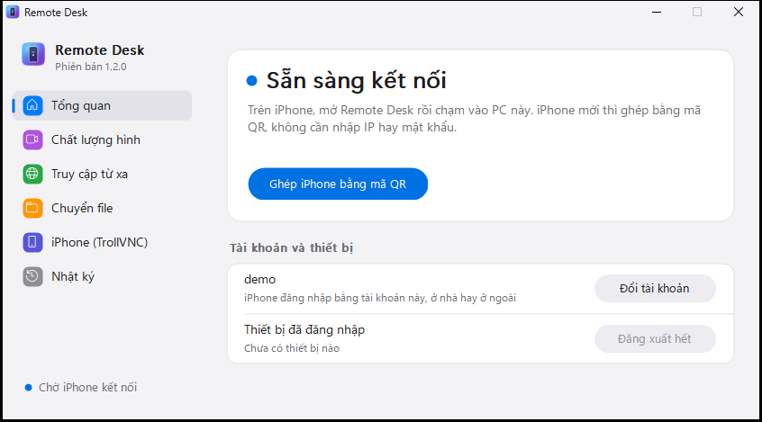
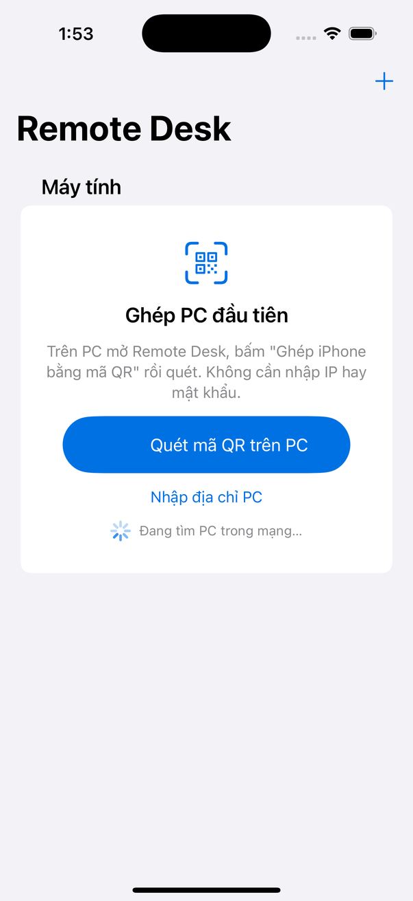
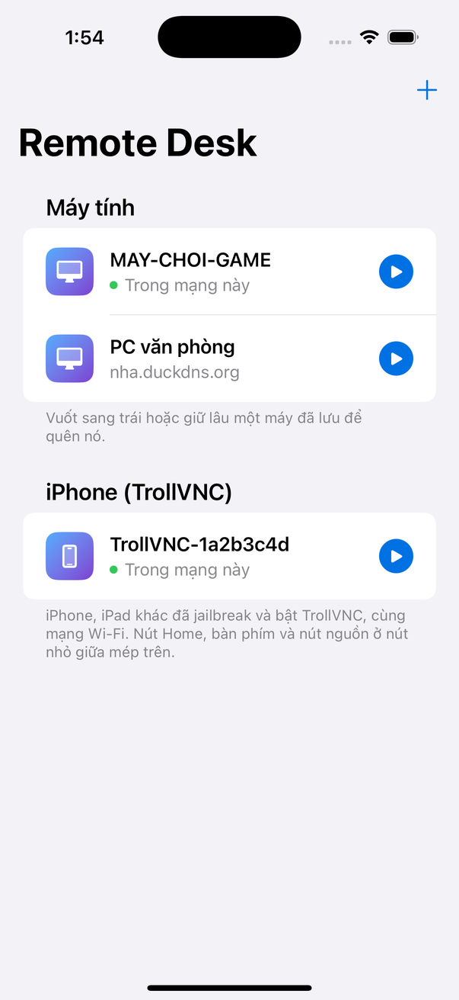
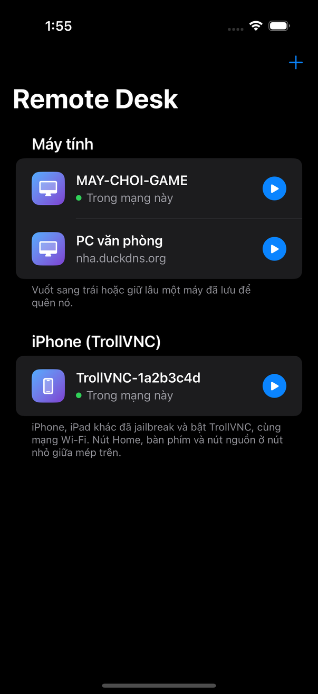
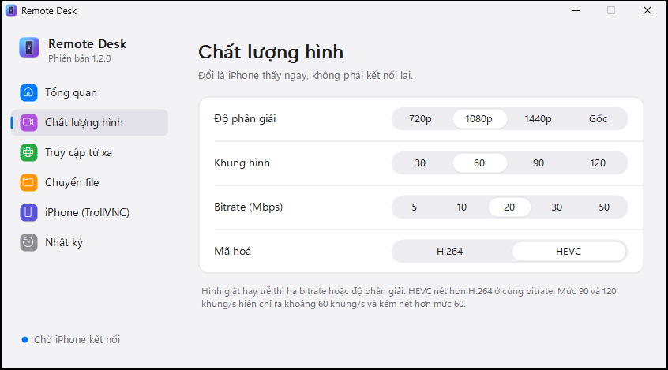
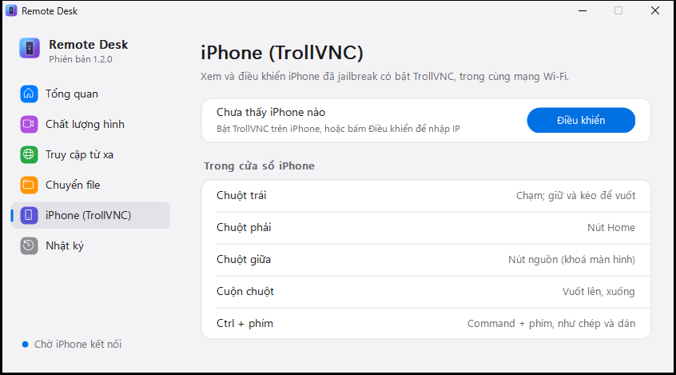

# Remote Desk

Điều khiển PC Windows từ iPhone, kiểu Moonlight: hình mã hoá bằng card đồ hoạ (HEVC/H.264), độ trễ thấp, keymap cho game.
Xem và điều khiển được cả iPhone đã jailbreak có cài TrollVNC, từ PC hoặc từ một iPhone khác.

  

  

**Tải bản dựng sẵn ở mục [Releases](../../releases)**, không cần build.

## Gồm những gì

| Phần | Mô tả |
|---|---|
| `remote_host.cpp` | App máy chủ trên PC (C++ thuần Win32). Chụp màn hình DXGI, mã hoá NVENC/QSV qua Media Foundation, WebSocket qua TLS (Schannel), ghép iPhone bằng mã QR, đăng nhập bằng tài khoản (PBKDF2 + khoá thiết bị), bitrate tự điều chỉnh, mở cổng router bằng UPnP, tên miền riêng (DDNS), chuyển file với iPhone, tự cập nhật, xem và điều khiển iPhone có TrollVNC (RFB, mã hoá Tight + JPEG). Giao diện có thanh bên như Cài đặt của Windows 11, sáng/tối theo Windows. |
| `ios/` | App iPhone (SwiftUI, iOS 15+, kính lỏng trên iOS 26). Giải mã phần cứng, quét mã QR trên PC, tự tìm PC trong mạng, tự chọn đường LAN / Internet. Keymap có sẵn cho Minecraft, CS2, Valorant, PUBG, Genshin, Star Rail, ZZZ, Wuthering Waves, Roblox, GTA V, MOBA (cần di chuyển, liên thanh, kéo để ngắm, con quay, nút "Chuột" bấm tại chỗ). Bảng điều khiển nổi: chất lượng hình, keymap, con quay, gửi file. Điều khiển iPhone/iPad khác có TrollVNC. |
| `remote_desktop.html` | Bản cho Safari (WebCodecs), PC tự phục vụ ở `https://<IP PC>:8443`. |

## Dùng lần đầu

1. Trên PC: chạy bộ cài `RemoteDesk-Windows-*-Setup.exe` (không cần quyền quản trị; hoặc giải nén bản zip), mở Remote Desk, tạo tài khoản, cho phép qua Windows Firewall.
2. Trên iPhone: cài `RemoteDesk-iOS-*-unsigned.ipa` bằng Sideloadly (Apple ID của bạn).
3. Trên PC, trang **Tổng quan**, bấm **Ghép iPhone bằng mã QR**. Trên iPhone bấm **Quét mã QR trên PC** (hoặc nút **+** góc trên, hoặc quét bằng app Camera). Không cần nhập IP hay mật khẩu. Lần sau chỉ cần chạm vào PC trong danh sách, ở nhà hay ở ngoài.

  
  

Các lần sau, mở app là thấy danh sách máy. Chấm xanh nghĩa là PC đang ở cùng mạng; vuốt sang trái để quên một máy.

  
  

## Chất lượng hình

Đổi độ phân giải, khung hình, bitrate và mã hoá ở trang **Chất lượng hình** trên PC, hoặc trong bảng điều khiển trên iPhone. Đổi là thấy ngay, không phải kết nối lại.

  

## Dùng ở ngoài

- Trên PC, trang **Truy cập từ xa**: bật **Từ Internet**. Router/modem phải chuyển cổng TCP 8443 về PC (PC tự mở cổng trên router có UPnP; modem nhà mạng thường phải làm tay một lần).
- Đặt **Tên miền riêng** (DDNS) để IP nhà đổi vẫn vào được. Tạo miễn phí ở [duckdns.org](https://www.duckdns.org), điền tên + token, PC tự cập nhật. Modem đã có DDNS thì chỉ cần điền tên.
- Ở xa và chưa ghép bằng mã QR: trên iPhone bấm **+** > **Thêm PC bằng địa chỉ**, nhập tên miền và tài khoản của PC.

## Chuyển file

- iPhone → PC: trong lúc điều khiển, mở bảng bằng nút nhỏ giữa mép trên, chọn **Gửi ảnh** hoặc **Gửi tệp**. File nằm trong thư mục **Tải về\Remote Desk** của PC.
- PC → iPhone: trang **Chuyển file** > **Chọn file…**, hoặc kéo file thả vào cửa sổ. iPhone tự tải về app **Tệp > Trên iPhone > Remote Desk > Nhận từ PC**, có nút Chia sẻ để lưu vào Ảnh.

## Điều khiển iPhone có TrollVNC

Cho iPhone/iPad đã jailbreak và cài [TrollVNC](https://github.com/owngoal-dev/TrollVNC), cùng mạng Wi‑Fi. Nên đặt mật khẩu VNC trong Cài đặt > TrollVNC.

- Trên PC: trang **iPhone (TrollVNC)** > **Điều khiển** (PC tự tìm iPhone qua Bonjour). Chuột trái là chạm, chuột phải là nút Home, chuột giữa là nút nguồn, cuộn chuột là vuốt, Ctrl + phím thành Command + phím.
- Trên một iPhone khác: mục **iPhone (TrollVNC)** trong danh sách, hoặc **+** > **Thêm iPhone (TrollVNC)**. Nút Home, bàn phím và nút nguồn ở nút nhỏ giữa mép trên.

  

## Cập nhật

- PC (bản cài bằng bộ cài): tự kiểm tra bản mới mỗi 6 giờ, tự tải và cài khi không có ai đang điều khiển, rồi tự mở lại. Muốn chỉ báo mà không tự cài: thêm `[app]` `autoupdate=0` vào `remote_settings.ini`.
- iPhone: app báo khi có bản mới. Cài bằng AltStore hoặc SideStore thì thêm nguồn `https://github.com/ductruongvu23/remote-desk/releases/latest/download/altstore.json` một lần (hoặc bấm **Thêm nguồn** trong app), các bản sau tự cập nhật.

## Tự build

- PC (MSYS2 UCRT64, `pacman -S mingw-w64-ucrt-x86_64-gcc mingw-w64-ucrt-x86_64-nsis mingw-w64-ucrt-x86_64-zlib`): `VERSION=1.2.3 bash build_host.sh` (bỏ `VERSION` thì là bản dev, không tự cập nhật), kiểm tra bằng `remote_host.exe --self-test`; bộ cài: `makensis -DVERSION=1.2.3 installer.nsi`.
- iPhone (Mac có Xcode 26+): `bash ios/build.sh` ra IPA chưa ký; `bash ios/build.sh --test` chạy self-test trên Simulator và chụp ảnh giao diện vào `ios/build/shots`. Hoặc mở `ios/RemoteDesk.xcodeproj`, chọn Team rồi Run.
- Phát hành: `git tag v1.2.3 && git push origin v1.2.3`. GitHub Actions build cả hai và tạo Release.
